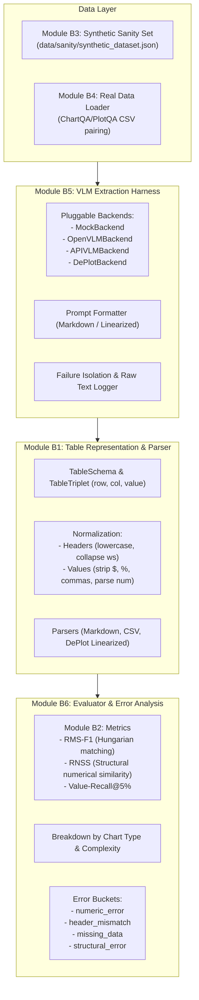

# Chart-to-Table Evaluation Pipeline

A lightweight, modular Python framework for extracting underlying data tables from chart images and evaluating table quality using **RMS-F1**, **RNSS**, and **Value-Recall@5%** metrics.

Based on the research paper **DePlot: One-shot visual language reasoning by plot-to-table translation** (*Liu et al., Findings of ACL 2023*).

---

## Architecture & Module Boundaries (B1–B6)



---

## 🧪 How to Run Tests

| Module | Location | Responsibilities & Implementations |
|---|---|---|
| **B1** | `src/format/` | **Table Representation & Parsers**: `TableTriplet` (row, col, value) and `TableSchema`. Header normalization (lowercase, collapse whitespace), cell value normalization (currency/comma/percent stripping and numeric coercion), markdown codeblock stripping, and parsers for Markdown, CSV, and Linearized DePlot formats. |
| **B2** | `src/metrics/` | **Metrics**: Mathematical formulations for `RMS-F1` (Normalized Levenshtein header matching with threshold $\tau = 0.5$, relative value distance $D = \min(1, |p - t| / |t|)$, Hungarian matching assignment via `scipy.optimize.linear_sum_assignment`), `RNSS` (structural numerical similarity), and `Value-Recall@5%`. |
| **B3** | `data/sanity/`, `src/data_loader/synthetic.py` | **Synthetic Sanity Set**: 6 diverse mock chart metadata and ground-truth tables (bar, line, grouped bar, horizontal bar, mixed complexity). |
| **B4** | `src/data_loader/loader.py` | **Real Data Loader**: Ingestion layer pairing image paths with gold CSV files (ChartQA / PlotQA format), converting CSV into Module B1 canonical tables with missing-file error logging. |
| **B5** | `src/models/harness.py` | **VLM Extraction Harness**: Pluggable backend architecture (`MockBackend`, `OpenVLMBackend`, `APIVLMBackend`, `DePlotBackend`), extraction prompt formatter, and isolated execution saving raw text and recording `parse_ok`. |
| **B6** | `src/evaluation/evaluator.py` | **Evaluation & Error Analysis**: Evaluates extraction against gold tables, computes aggregations broken down by chart type and complexity, and categorizes failures into actionable error buckets (`numeric_error`, `header_mismatch`, `missing_data`, `structural_error`). |

### 1. Run Gate 1 (Week 4) Mandatory Tests
Verifies the 5 mandatory acceptance test cases for Module B2 metrics:
```bash
pytest tests/test_gate1_rms_f1.py::TestGate1Mandatory -v
```
**Expected outcome:** `5 passed`.

### 2. Run All Metric Tests (RMS-F1, RNSS, Value-Recall, Pairwise)
```bash
pytest tests/test_gate1_rms_f1.py -v
```
**Expected outcome:** `29 passed` (covers exact matches, permutations, numeric errors, text omissions, edge cases, and Week 3 pairwise metric tests).

### 3. Run the Entire Test Suite
```bash
pytest tests/ -v
```
**Expected outcome:** `39 passed` across all modules (B1–B6).

### 4. Run End-to-End Pipeline Smoke Test
```bash
python main.py
```
Runs a complete mock run: loads synthetic charts, simulates extraction, parses tables, and computes metric breakdowns.

---

## 📊 Core Metrics Explained (Module B2)

This repository implements the evaluation metrics defined in Section 3.1 of the DePlot paper:

### 1. `RMS-F1` (Relative Mapping Similarity F1) — Primary Metric
Measures structural and numeric alignment between predicted and ground-truth tables:
- **Canonical Representation:** Tables are represented as sets of cell triplets: `(row, col, value)`.
- **Header Distance ($NL_\tau$):** Normalized Levenshtein distance on column headers with a cutoff threshold $\tau = 0.5$.
- **Value Distance ($D$):** Relative error $D(p, t) = \min(1, |p - t| / |t|)$ for numbers; exact match for text.
- **Pair Similarity:** $\text{sim} = (1 - NL_\tau) \times (1 - D) \in [0.0, 1.0]$.
- **Hungarian Matching:** Computes optimal 1-to-1 bipartite assignment minimizing $(1 - \text{sim})$.
- **Aggregation:** Calculates Precision, Recall, and Harmonic Mean ($F_1$). Invariant to row/column permutations.

### 2. `RNSS` (Relative Number Set Similarity) — Baseline Metric
Evaluates the unordered set of numeric values, ignoring headers and table structure:
$$\text{RNSS} = 1 - \frac{\sum_{\text{matched}} D(p_i, t_j)}{\max(N, M)}$$

### 3. `Value-Recall@5%`
The percentage of ground-truth numbers correctly captured within a $\le 5\%$ relative error margin.

---

## 🎯 Gate 1 Acceptance Criteria (5 Mandatory Cases)

| Test Case | Scenario | Expected Result | Verified By |
| :--- | :--- | :--- | :--- |
| **C1** | Exact match | $F_1 = 1.0$, $P = 1.0$, $R = 1.0$ | `test_c1_identical_tables` |
| **C2** | Shuffled row order | $F_1 = 1.0$ (Row-invariance) | `test_c2_row_permutation` |
| **C3** | ~3% numeric deviation | $F_1 \in [0.90, 0.99]$ | `test_c3_small_numeric_error` |
| **C4** | Missing 50% of rows | $\text{Recall} \approx 0.50$, $F_1 \approx 0.67$ | `test_c4_missing_half_rows` |
| **C5** | Typo in column header | $F_1 \in [0.70, 0.99]$ (Partial credit) | `test_c5_header_typo` |

---

## 📂 Project Structure

```text
chart-to-table/
├── src/
│   ├── format/           # [Module B1] Table representations & parsers (Markdown, CSV, Linearized)
│   │   ├── parser.py     # Cleaners, normalizers, text format parsers
│   │   └── schema.py     # TableSchema & TableTriplet data models
│   ├── metrics/          # [Module B2] Evaluation metrics
│   │   └── table_metrics.py # compute_rms_f1, compute_rnss, compute_value_recall_at_5
│   ├── data_loader/      # [Modules B3 & B4] Synthetic & benchmark data loaders
│   ├── models/           # [Module B5] VLM extraction harness (Mock, Open, API)
│   └── evaluation/       # [Module B6] Evaluator & error categorization
├── tests/
│   ├── test_gate1_rms_f1.py # Gate 1 mandatory tests + RNSS & recall tests (19 tests)
│   └── test_pipeline.py     # End-to-end integration tests (10 tests)
├── data/
│   └── sanity/           # Synthetic chart tables for testing
├── main.py               # Quick demo & smoke test
└── requirements.txt      # Project dependencies
```

---

## Pipeline Architecture

## 1. Source Layout

```text
src/
├── data_loader/
├── evaluation/
├── format/
│   ├── __init__.py
│   ├── formatter.py
│   ├── parser.py
│   └── schema.py
├── metrics/
├── models/
│   ├── __init__.py
│   ├── deplot.py
│   ├── harness.py
│   └── vlm_client.py
├── __init__.py
└── pipeline.py

tests/
├── fixtures/
│   └── deplot_output.txt
├── __init__.py
├── test_deplot.py
├── test_format.py
├── test_pipeline.py
└── test_processing.py
```

The screenshot may show generated `__pycache__` directories as well. These are Python-generated bytecode caches, not source modules that developers normally need to edit.

### Main responsibilities

| Module | Responsibility |
|---|---|
| `src/pipeline.py` | Public processing functions; coordinates extraction, parsing, and serialization. |
| `src/models/harness.py` | Provides the table-extraction interface and connects a backend to the parser. |
| `src/models/deplot.py` | Wraps the DePlot model: image validation/loading, inference, and decoded text output. |
| `src/format/parser.py` | Converts raw DePlot text into structured table data. |
| `src/format/schema.py` | Defines the canonical table representation and its table-related behavior. |
| `src/format/formatter.py` | Serializes a canonical table into Linearized, Markdown, and CSV formats. |
| `src/format/__init__.py` | Re-exports public formatting/parser/schema APIs for convenient imports. |
| `src/models/vlm_client.py` | Placeholder for a future Table-QA or VLM-client stage; not part of the current chart-to-table path. |
| `tests/fixtures/deplot_output.txt` | Fixed raw DePlot output used for deterministic tests. |
| `tests/test_*.py` | Tests extraction wrappers, formatting, pipeline behavior, and processing. |

## 2. High-Level Architecture

```text
Chart image + requested output format
                 |
                 v
          src/pipeline.py
      process_chart(...) or
      process_all_chart(...)
                 |
                 v
           _extract_table(...)
                 |
                 v
         VLMTableHarness
                 |
                 v
       DePlotBackend.predict(...)
                 |
                 v
          Raw DePlot text
                 |
                 v
       DePlot output parser
                 |
                 v
           TableSchema
      columns / rows / title /
            triplets
                 |
          +------+------+ 
          |      |      |
          v      v      v
      Linearized Markdown CSV
          |      |      |
          +------+------+ 
                 |
                 v
       Return string(s) to caller
```

The central design principle is **extract and parse once, then serialize the same canonical table into whichever output format is requested**. This keeps the three outputs consistent and avoids repeating model inference unnecessarily.

## 3. Testing Workflow

The tests are organized around the extraction, formatting, and pipeline responsibilities.

| Test location | Main purpose |
|---|---|
| `tests/fixtures/deplot_output.txt` | Stable example of raw DePlot output. |
| `tests/test_deplot.py` | DePlot wrapper/backend behavior. |
| `tests/test_format.py` | Parser, schema, and serializer behavior. |
| `tests/test_pipeline.py` | Pipeline entry points and output selection. |
| `tests/test_processing.py` | Processing and integration behavior. |

## 4. Summary

The current system has a straightforward flow:

**`src.pipeline` → `VLMTableHarness` → `DePlotBackend` → DePlot raw text → parser → `TableSchema` → formatter → returned output string(s).**

The pipeline coordinates the work; the harness connects model inference and parsing; DePlot extracts text from the image; the parser creates the canonical table; and the formatter serializes that table for LLM context, Markdown display, or CSV-based data processing.

When debugging or extending the repository, follow these boundaries and use the tests to confirm the existing contracts before changing behavior.

---

## Execution & Verification

You can compute metrics directly in your own scripts:

```python
from src.format.schema import TableSchema
from src.metrics.table_metrics import compute_rms_f1, compute_rnss, compute_value_recall_at_5

# Define Ground-Truth table
gold = TableSchema(
    columns=["Quarter", "Revenue"],
    rows=[["Q1", 100.0], ["Q2", 150.0]]
)

# Define Model Prediction (e.g., with ~3% error)
pred = TableSchema(
    columns=["Quarter", "Revenue"],
    rows=[["Q1", 103.0], ["Q2", 154.5]]
)

# Compute metrics
rms = compute_rms_f1(pred, gold)
print("RMS-F1:         ", round(rms["f1"], 4))
print("RNSS:           ", round(compute_rnss(pred, gold), 4))
print("Value-Recall@5%:", compute_value_recall_at_5(pred, gold))
```

Output:
```text
RMS-F1:          0.97
RNSS:            0.97
Value-Recall@5%: 1.0
```
The tests cover parsers, normalization, metric calculations, synthetic datasets, extraction backends, and evaluator error categorization.

### 3. Process a Chart
`process_chart` returns one selected format. `process_all_chart` runs extraction once and returns Linearized DePlot, Markdown, and CSV strings. DePlot weights are loaded on the first extraction and may be downloaded from Hugging Face.

```python
from src.pipeline import process_all_chart

outputs = process_all_chart("data/raw/chart.png")
print(outputs["markdown"])
```
### 4. Run Test For Workflow Pipeline
```bash
python -m tests.test_deplot
python -m tests.test_format
python -m tests.test_pipeline
python -m tests.test_processing
```
The tests cover DePlot module call, format normalization for numerical value, pipeline workflow, processing data.
