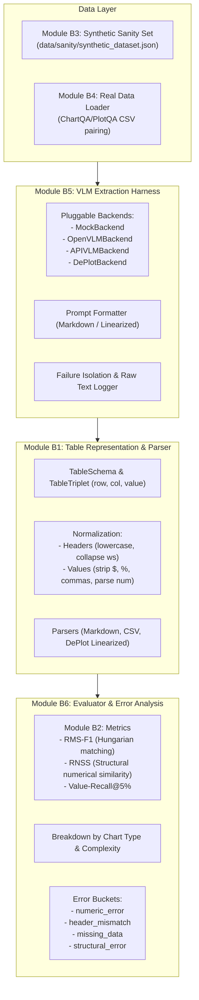

# Chart-to-Table: Modular Pipeline Architecture (Modules B1–B6)

[](https://www.python.org/)
[](LICENSE)
[](https://docs.pydantic.dev/)

A clean, modular repository implementing **Stage 1 (Chart-to-Table)** extraction, canonical table modeling, and evaluation metrics across Modules B1 to B6.

---

## Architecture & Module Boundaries (B1–B6)



---

## Module Breakdown

| Module | Location | Responsibilities & Implementations |
|---|---|---|
| **B1** | `src/format/` | **Table Representation & Parsers**: `TableTriplet` (row, col, value) and `TableSchema`. Header normalization (lowercase, collapse whitespace), cell value normalization (currency/comma/percent stripping and numeric coercion), markdown codeblock stripping, and parsers for Markdown, CSV, and Linearized DePlot formats. |
| **B2** | `src/metrics/` | **Metrics**: Mathematical formulations for `RMS-F1` (Normalized Levenshtein header matching with threshold $\tau = 0.5$, relative value distance $D = \min(1, |p - t| / |t|)$, Hungarian matching assignment via `scipy.optimize.linear_sum_assignment`), `RNSS` (structural numerical similarity), and `Value-Recall@5%`. |
| **B3** | `data/sanity/`, `src/data_loader/synthetic.py` | **Synthetic Sanity Set**: 6 diverse mock chart metadata and ground-truth tables (bar, line, grouped bar, horizontal bar, mixed complexity). |
| **B4** | `src/data_loader/loader.py` | **Real Data Loader**: Ingestion layer pairing image paths with gold CSV files (ChartQA / PlotQA format), converting CSV into Module B1 canonical tables with missing-file error logging. |
| **B5** | `src/models/harness.py` | **VLM Extraction Harness**: Pluggable backend architecture (`MockBackend`, `OpenVLMBackend`, `APIVLMBackend`, `DePlotBackend`), extraction prompt formatter, and isolated execution saving raw text and recording `parse_ok`. |
| **B6** | `src/evaluation/evaluator.py` | **Evaluation & Error Analysis**: Evaluates extraction against gold tables, computes aggregations broken down by chart type and complexity, and categorizes failures into actionable error buckets (`numeric_error`, `header_mismatch`, `missing_data`, `structural_error`). |

---

## Directory Layout

```
chart-to-table/
├── configs/
│   └── config.yaml              # Declarative experiment configuration
├── data/
│   ├── raw/                     # Benchmark datasets (ChartQA, PlotQA)
│   └── sanity/
│       ├── sample_table.json    # Single sample fixture
│       └── synthetic_dataset.json # Module B3: 6 synthetic chart fixtures
├── src/
│   ├── format/                  # [Module B1] Table representations & parsers
│   │   ├── __init__.py
│   │   ├── parser.py            # Normalizers, codeblock strippers, format parsers
│   │   └── schema.py            # TableTriplet, TableSchema
│   ├── metrics/                 # [Module B2] Evaluation metrics
│   │   ├── __init__.py
│   │   └── table_metrics.py     # RMS-F1 (Hungarian), RNSS, Value-Recall@5%
│   ├── data_loader/             # [Modules B3 & B4] Data ingestion
│   │   ├── __init__.py
│   │   ├── loader.py            # Real ChartQA/PlotQA loader
│   │   └── synthetic.py         # Synthetic benchmark loader
│   ├── models/                  # [Module B5] Extraction harnesses
│   │   ├── __init__.py
│   │   ├── deplot.py            # Minimal DePlot stub
│   │   └── harness.py           # Pluggable VLMTableHarness (Mock, Open, API)
│   └── evaluation/              # [Module B6] Evaluation & error analysis
│       ├── __init__.py
│       └── evaluator.py         # PipelineEvaluator & categorize_error
├── tests/
│   ├── __init__.py
│   └── test_pipeline.py         # 10 unit tests covering Modules B1 to B6
├── .gitignore
├── requirements.txt             # Lightweight dependencies
├── main.py                      # End-to-end smoke test script
└── README.md                    # Project documentation
```

---

## Pipeline Architecture

## 1. Source Layout

```text
src/
├── data_loader/
├── evaluation/
├── format/
│   ├── __init__.py
│   ├── formatter.py
│   ├── parser.py
│   └── schema.py
├── metrics/
├── models/
│   ├── __init__.py
│   ├── deplot.py
│   ├── harness.py
│   └── vlm_client.py
├── __init__.py
└── pipeline.py

tests/
├── fixtures/
│   └── deplot_output.txt
├── __init__.py
├── test_deplot.py
├── test_format.py
├── test_pipeline.py
└── test_processing.py
```

The screenshot may show generated `__pycache__` directories as well. These are Python-generated bytecode caches, not source modules that developers normally need to edit.

### Main responsibilities

| Module | Responsibility |
|---|---|
| `src/pipeline.py` | Public processing functions; coordinates extraction, parsing, and serialization. |
| `src/models/harness.py` | Provides the table-extraction interface and connects a backend to the parser. |
| `src/models/deplot.py` | Wraps the DePlot model: image validation/loading, inference, and decoded text output. |
| `src/format/parser.py` | Converts raw DePlot text into structured table data. |
| `src/format/schema.py` | Defines the canonical table representation and its table-related behavior. |
| `src/format/formatter.py` | Serializes a canonical table into Linearized, Markdown, and CSV formats. |
| `src/format/__init__.py` | Re-exports public formatting/parser/schema APIs for convenient imports. |
| `src/models/vlm_client.py` | Placeholder for a future Table-QA or VLM-client stage; not part of the current chart-to-table path. |
| `tests/fixtures/deplot_output.txt` | Fixed raw DePlot output used for deterministic tests. |
| `tests/test_*.py` | Tests extraction wrappers, formatting, pipeline behavior, and processing. |

## 2. High-Level Architecture

```text
Chart image + requested output format
                 |
                 v
          src/pipeline.py
      process_chart(...) or
      process_all_chart(...)
                 |
                 v
           _extract_table(...)
                 |
                 v
         VLMTableHarness
                 |
                 v
       DePlotBackend.predict(...)
                 |
                 v
          Raw DePlot text
                 |
                 v
       DePlot output parser
                 |
                 v
           TableSchema
      columns / rows / title /
            triplets
                 |
          +------+------+ 
          |      |      |
          v      v      v
      Linearized Markdown CSV
          |      |      |
          +------+------+ 
                 |
                 v
       Return string(s) to caller
```

The central design principle is **extract and parse once, then serialize the same canonical table into whichever output format is requested**. This keeps the three outputs consistent and avoids repeating model inference unnecessarily.

## 3. Testing Workflow

The tests are organized around the extraction, formatting, and pipeline responsibilities.

| Test location | Main purpose |
|---|---|
| `tests/fixtures/deplot_output.txt` | Stable example of raw DePlot output. |
| `tests/test_deplot.py` | DePlot wrapper/backend behavior. |
| `tests/test_format.py` | Parser, schema, and serializer behavior. |
| `tests/test_pipeline.py` | Pipeline entry points and output selection. |
| `tests/test_processing.py` | Processing and integration behavior. |

## 4. Summary

The current system has a straightforward flow:

**`src.pipeline` → `VLMTableHarness` → `DePlotBackend` → DePlot raw text → parser → `TableSchema` → formatter → returned output string(s).**

The pipeline coordinates the work; the harness connects model inference and parsing; DePlot extracts text from the image; the parser creates the canonical table; and the formatter serializes that table for LLM context, Markdown display, or CSV-based data processing.

When debugging or extending the repository, follow these boundaries and use the tests to confirm the existing contracts before changing behavior.

---

## Execution & Verification

### 1. Run Smoke Test
```bash
python main.py
```
Executes an end-to-end smoke run: loads Module B3 synthetic data, extracts via Module B5 MockBackend, parses via Module B1, evaluates with Module B2 metrics, and produces Module B6 breakdowns by chart type, complexity, and error categories.

### 2. Run Test Suite
```bash
pytest tests/ -v
```
The tests cover parsers, normalization, metric calculations, synthetic datasets, extraction backends, and evaluator error categorization.

### 3. Process a Chart
`process_chart` returns one selected format. `process_all_chart` runs extraction once and returns Linearized DePlot, Markdown, and CSV strings. DePlot weights are loaded on the first extraction and may be downloaded from Hugging Face.

```python
from src.pipeline import process_all_chart

outputs = process_all_chart("data/raw/chart.png")
print(outputs["markdown"])
```
### 4. Run Test For Workflow Pipeline
```bash
python -m tests.test_deplot
python -m tests.test_format
python -m tests.test_pipeline
python -m tests.test_processing
```
The tests cover DePlot module call, format normalization for numerical value, pipeline workflow, processing data.