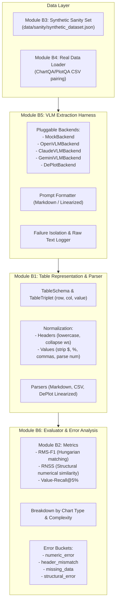

# Chart-to-Table Evaluation Pipeline

A lightweight, modular Python framework for extracting underlying data tables from chart images and evaluating table quality using **RMS-F1**, **RNSS**, and **Value-Recall@5%** metrics.

Based on the research paper **DePlot: One-shot visual language reasoning by plot-to-table translation** (*Liu et al., Findings of ACL 2023*).

---

## Getting Started

Run commands from the repository root. Python dependencies, including the Gemini and Claude SDKs, are listed in `requirements.txt`.

```powershell
git clone https://github.com/theDoub/HK261-DAGD1-081.git
cd HK261-DAGD1-081
python -m venv .venv
.\.venv\Scripts\Activate.ps1
python -m pip install --upgrade pip
python -m pip install -r requirements.txt
python main.py --help
```

On macOS/Linux, activate the environment with `source .venv/bin/activate` instead.

### Extract a table from one image

Pass one local PNG, JPG/JPEG, or WEBP image with `--image`. This mode does not require a dataset or ground-truth table; it prints the parsed Markdown table and raw model response. Add `--output` to save a JSON record containing the response, parse status, errors, and parsed table.

```powershell
python main.py --image "C:\charts\chart.png" --backend deplot --output "outputs\single\chart.json"
```

The default backend is DePlot. It may download model weights the first time it runs and requires internet access. Gemini and Claude use their respective hosted APIs; set the provider API key in the current PowerShell session before running:

```powershell
$env:GEMINI_API_KEY = "YOUR_GEMINI_API_KEY"
python main.py --image "C:\charts\chart.png" --backend gemini --output "outputs\single\chart-gemini.json"

$env:ANTHROPIC_API_KEY = "YOUR_ANTHROPIC_API_KEY"
python main.py --image "C:\charts\chart.png" --backend claude --output "outputs\single\chart-claude.json"
```

For local Qwen2.5-VL inference, use the same command with `--backend qwen`:

```powershell
python main.py --image "C:\charts\chart.png" --backend qwen --output "outputs\single\chart-qwen.json"
```

Qwen model settings (model ID, device, quantization, generation limit, and prompt) come from the `qwen` section of `configs/config.yaml`. The default 4-bit quantization requires a supported CUDA setup and BitsAndBytes (`python -m pip install bitsandbytes`); on CPU, change `quantization` to `none` in that config. The model weights are downloaded from Hugging Face the first time; the 7B model needs substantial system/GPU memory. To use a smaller compatible checkpoint or change the device, update the config.

For macOS/Linux shells, set the API key with `export GEMINI_API_KEY="YOUR_GEMINI_API_KEY"` or `export ANTHROPIC_API_KEY="YOUR_ANTHROPIC_API_KEY"` and pass an image path such as `./charts/chart.png`.

The API keys are not stored in the repository or response cache. Hosted API requests may incur charges; a Claude chat subscription does not include Claude API usage. Gemini quotas and free-tier eligibility vary. Check the official [Gemini API pricing](https://ai.google.dev/gemini-api/docs/pricing) and [Anthropic API pricing](https://platform.claude.com/docs/en/about-claude/pricing) before making requests. Repeated requests use the local response cache by default; pass `--no-api-cache` to bypass cache reads and writes. The default cache directory is `.cache/chart_to_table/api_responses`.

The configured models default to `google/deplot`, `Qwen/Qwen2.5-VL-7B-Instruct`, `gemini-3.5-flash-lite`, and `claude-3-5-sonnet-20241022`; edit the relevant sections in `configs/config.yaml` to change them. Invalid images or unsuccessful extraction/parsing return a non-zero process exit code. For a hosted API call, the selected API key must be set; installing the SDK alone does not provide API access.

### Evaluate the ChartQA dataset

Dataset mode requires ChartQA files locally under `data/raw/ChartQA_Dataset/test` (images and paired tables). Select the split in `configs/config.yaml`:

```powershell
python main.py --chartqa --backend deplot
python main.py --chartqa --backend qwen --max-samples 10
python main.py --chartqa --backend gemini --max-samples 10
python main.py --chartqa --backend claude --no-sample-limit
```

Gemini/Claude dataset runs are capped at 10 samples by default to limit API usage. `--max-samples N` selects a smaller or larger cap; `--no-sample-limit` explicitly evaluates all samples. DePlot and Qwen evaluate all samples unless capped with `--max-samples`. Dataset predictions are written as JSONL files under `outputs/predictions/`. Hosted API keys and cache options are the same as for single-image mode.

### Run a paired Qwen prompt evaluation

For a prompt-only comparison, freeze the pre-change Qwen prompt in a UTF-8 text file and put the same newline-delimited sample IDs in a second file. Run both evaluations with identical model, device, quantization, token limit, dataset, and sample-ID options. By default, the evaluator reads `qwen.max_new_tokens` from `configs/config.yaml`; pass `--max-new-tokens` only to override it for both runs. The baseline uses `--prompt-file`; the candidate uses the prompt in the config. Each report records its exact prompt and inference conditions. A report produced before this metadata was added cannot verify its original prompt or settings.

The Qwen evaluator supports `--output-format markdown` (default) and `--output-format linearized`. Markdown uses `qwen.prompt_markdown`, while linearized uses `qwen.prompt_linearized`; a `--prompt-file` always overrides the selected configured prompt. Linearized output is restricted to Qwen/OpenVLM and uses the existing DePlot linearized parser. Report comparisons allow an intentional Markdown-versus-linearized format ablation, while still rejecting changes to model, device, quantization, token limit, dataset, backend, or sample set.

### 1. PowerShell

```powershell
$env:PYTHONPATH = (Get-Location).Path

# CPU inference does not support 4-bit quantization in this backend.
python scripts/evaluate_gate2.py `
  --backend qwen `
  --data-dir data/chartqa_test `
  --sample-ids-file outputs/chartqa_ab_ids.txt `
  --prompt-file outputs/qwen_baseline.prompt `
  --device cpu `
  --quantization none `
  --output outputs/qwen_baseline_report.json

python scripts/evaluate_gate2.py `
  --backend qwen `
  --data-dir data/chartqa_test `
  --sample-ids-file outputs/chartqa_ab_ids.txt `
  --device cpu `
  --quantization none `
  --output outputs/qwen_candidate_report.json

python scripts/compare_gate2_reports.py `
  --baseline outputs/qwen_baseline_report.json `
  --candidate outputs/qwen_candidate_report.json `
  --output outputs/qwen_prompt_comparison.json

python scripts/analyze_header_mismatches.py `
  --report outputs/qwen_candidate_report.json `
  --data-dir data/chartqa_test `
  --output-json outputs/qwen_header_mismatch_analysis.json
```

### 2. Linux / WSL (Bash)

```bash
export PYTHONPATH=\$(pwd)

# CPU inference does not support 4-bit quantization in this backend.
python scripts/evaluate_gate2.py \
  --backend qwen \
  --data-dir data/chartqa_test \
  --sample-ids-file outputs/chartqa_ab_ids.txt \
  --prompt-file outputs/qwen_baseline.prompt \
  --device cpu \
  --quantization none \
  --output outputs/qwen_baseline_report.json

python scripts/evaluate_gate2.py \
  --backend qwen \
  --data-dir data/chartqa_test \
  --sample-ids-file outputs/chartqa_ab_ids.txt \
  --device cpu \
  --quantization none \
  --output outputs/qwen_candidate_report.json

python scripts/compare_gate2_reports.py \
  --baseline outputs/qwen_baseline_report.json \
  --candidate outputs/qwen_candidate_report.json \
  --output outputs/qwen_prompt_comparison.json

python scripts/analyze_header_mismatches.py \
  --report outputs/qwen_candidate_report.json \
  --data-dir data/chartqa_test \
  --output-json outputs/qwen_header_mismatch_analysis.json
```

CPU inference with the 7B model requires substantial RAM and may be very slow. If CUDA is available, use `--device cuda --quantization 4bit` for both evaluation commands instead. The comparison rejects reports with different sample IDs or recorded inference conditions, and reports aggregate and per-sample outcomes; both the comparison and mismatch analyzer reject reports where every sample failed at backend initialization.

The Qwen chart-extraction prompt specifies separate row/column layouts for line charts, horizontal or vertical grouped/stacked bars, single-series bars, and pie charts. Re-run the paired evaluation after changing these rules; mismatch-category counts alone do not measure an RMS-F1 regression or improvement.

For linearized output, the parser distinguishes explicit `<START>`/`<NEW_ROW>`/`<END>` responses from legacy DePlot text. Explicit responses require a valid header and equal-width rows; malformed row tokens or mismatched widths return a parse error instead of silently padding or truncating fields. Legacy DePlot-style pipe text remains supported.

---

## Architecture & Module Boundaries (B1–B6)



---

## 🧪 How to Run Tests

| Module | Location | Responsibilities & Implementations |
|---|---|---|
| **B1** | `src/format/` | **Table Representation & Parsers**: `TableTriplet` (row, col, value) and `TableSchema`. Header normalization (lowercase, collapse whitespace), cell value normalization (currency/comma/percent stripping and numeric coercion), markdown codeblock stripping, and parsers for Markdown, CSV, and Linearized DePlot formats. |
| **B2** | `src/metrics/` | **Metrics**: Mathematical formulations for `RMS-F1` (Normalized Levenshtein header matching with threshold $\tau = 0.5$, relative value distance $D = \min(1, |p - t| / |t|)$, Hungarian matching assignment via `scipy.optimize.linear_sum_assignment`), `RNSS` (structural numerical similarity), and `Value-Recall@5%`. |
| **B3** | `data/sanity/`, `src/data_loader/synthetic.py` | **Synthetic Sanity Set**: 6 diverse mock chart metadata and ground-truth tables (bar, line, grouped bar, horizontal bar, mixed complexity). |
| **B4** | `src/data_loader/loader.py` | **Real Data Loader**: Ingestion layer pairing image paths with gold CSV files (ChartQA / PlotQA format), converting CSV into Module B1 canonical tables with missing-file error logging. |
| **B5** | `src/models/`<br>*(including `harness.py`, `claude.py`, `gemini.py`, `api_cache.py`)* | **VLM Extraction Harness**: Shared extraction contract and execution runner (`harness.py`) featuring a pluggable backend architecture (`MockBackend`, local Transformers-backed `OpenVLMBackend` for Qwen2.5-VL, `APIVLMBackend`, `DePlotBackend`), provider-specific API logic (`claude.py`, `gemini.py`), persistent response caching (`api_cache.py`), extraction prompt formatters, and isolated execution tracking raw text and `parse_ok`. |
| **B6** | `src/evaluation/evaluator.py` | **Evaluation & Error Analysis**: Evaluates extraction against gold tables, computes aggregations broken down by chart type and complexity, and categorizes failures into actionable error buckets (`numeric_error`, `header_mismatch`, `missing_data`, `structural_error`). |

### 1. Run Gate 1 (Week 4) Mandatory Tests
Verifies the 5 mandatory acceptance test cases for Module B2 metrics:
```bash
pytest tests/test_gate1_rms_f1.py::TestGate1Mandatory -v
```
**Expected outcome:** `5 passed`.

### 2. Run All Metric Tests (RMS-F1, RNSS, Value-Recall, Pairwise)
```bash
pytest tests/test_gate1_rms_f1.py -v
```
**Expected outcome:** `29 passed` (covers exact matches, permutations, numeric errors, text omissions, edge cases, and Week 3 pairwise metric tests).

### 3. Run the Entire Test Suite
```bash
pytest tests/ -v
```
**Expected outcome:** All discovered tests pass across the pipeline and API backends. API tests use fake clients and do not send network requests.

### 4. Run End-to-End Pipeline Smoke Test
```bash
python main.py
```
Runs a complete mock run: loads synthetic charts, simulates extraction, parses tables, and computes metric breakdowns.

### 5. Evaluate the Local ChartQA Test Split with DePlot
```bash
python main.py --chartqa
```
Runs the configured DePlot model on `data/raw/ChartQA_Dataset/test`, evaluates every chart image, and writes one JSONL record per sample under `outputs/predictions/`. Each record includes the image path, backend, unmodified model text, parse status, evaluation metrics, and any extraction or parsing error. The dataset must already be present locally; Transformers may download model weights if they are not cached.

### 6. Evaluate ChartQA with Gemini or Claude
Install the requirements, set the API key for the provider you intend to use, then explicitly select that backend:

```powershell
$env:GEMINI_API_KEY = "..."
python main.py --chartqa --backend gemini

$env:ANTHROPIC_API_KEY = "..."
python main.py --chartqa --backend claude
```

The default hosted-API models are `gemini-3.5-flash-lite` and `claude-3-5-sonnet-20241022`; edit `api_vlm` in `configs/config.yaml` to select other supported models. Keys are read from environment variables and are not written to the response cache. Hosted API runs are capped at 10 samples by default; set a different cap with `--max-samples 25`, or explicitly evaluate the full dataset with `--no-sample-limit`. `--no-api-cache` disables local cache reads and writes. Successful responses are cached under `.cache/chart_to_table/api_responses`, keyed by provider, model, prompt, and image content.

**Billing notice:** Hosted model calls can incur provider charges. Gemini offers a limited free tier for eligible models and quotas; Claude API usage is billed separately from ordinary Claude chat subscriptions. Pricing and free-tier terms can change; consult the official [Gemini API pricing](https://ai.google.dev/gemini-api/docs/pricing) and [Anthropic API pricing](https://platform.claude.com/docs/en/about-claude/pricing) before running. The sample cap and local cache reduce repeated usage but are not a hard spending limit. Tests use mock clients and do not call paid APIs.
